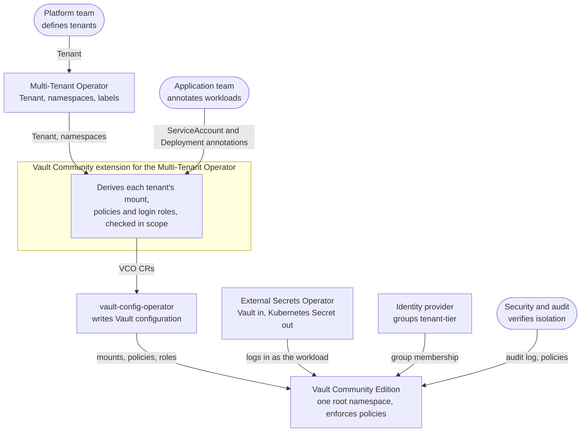
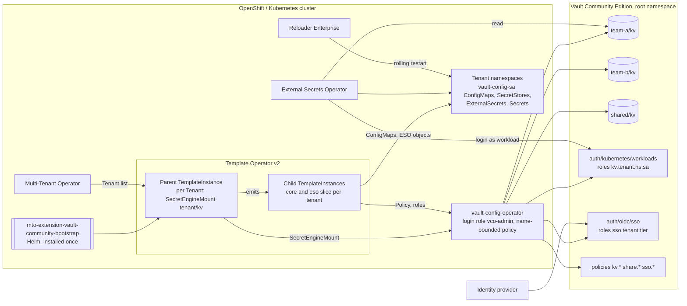
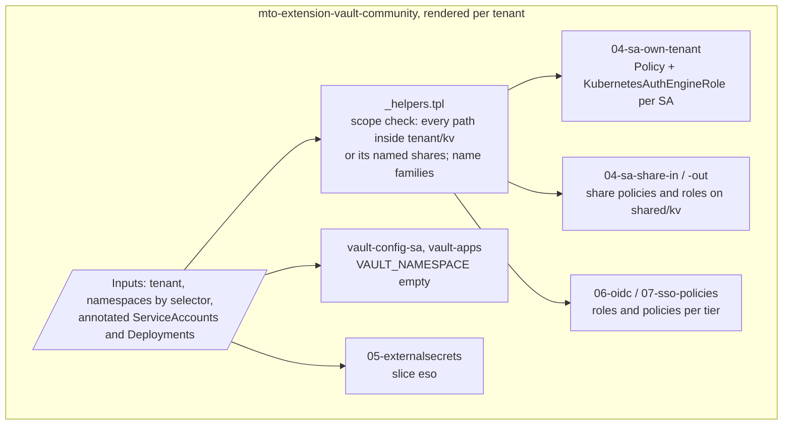
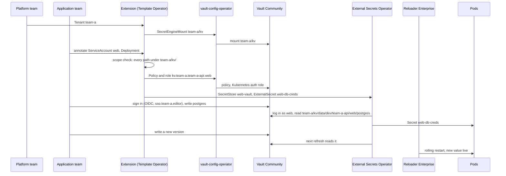
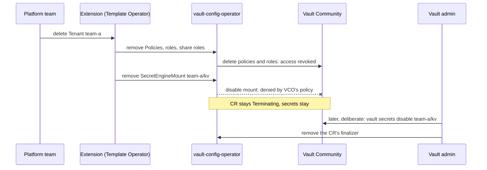
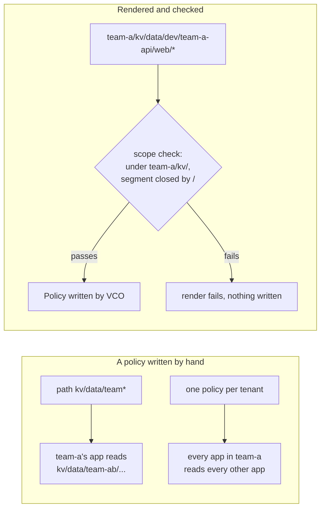

# Diagrams

C4 views (context → container → component) and the main flows. Mermaid; render
in GitHub or any Mermaid viewer.

## C4 — Context

## C4 — Container

## C4 — Component (per-tenant chart)

## Onboard, deliver, rotate

## Offboard

## The leak this design closes

