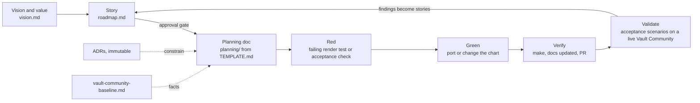

# Method — story → plan → red → green → verify → validate

How this extension is built. Adapted from the KubeWard method
(`stakater-ab/kube-ward` `docs/method.md`), itself a customised BMAD: brief and
PRD ↔ `vision.md` and `roadmap.md`, architect ↔ ADRs, story files ↔ story +
planning-doc pairs, QA gate ↔ `make` and acceptance scenarios.

## The loop

The **inner loop** ships one story. The **outer loop** validates on a live
Vault Community install against `acceptance.md` — the isolation contract is only proven
there, not by green render tests.

## Practices and where each is enforced

| Practice | Here | Enforced by |
|---|---|---|
| Spec first | vision → story → planning doc before chart changes | workflow in CLAUDE.md; planning doc committed first |
| Immutable decisions | `docs/adr/`, superseded never edited | review |
| Story-driven | house format, Done line, acceptance ids, lifecycle | roadmap; PRs cite the story |
| Test first | a failing render test (golden, schema, guard) or an acceptance check before the change | `make` (once the charts exist); review |
| Facts before design | Vault Community behaviour cited to `vault-community-baseline.md` rows; unknowns marked VERIFY | review; C.0 |
| Live validation | acceptance scenarios on Vault Community 2.1.1 | validation report per phase |
| Honesty | "not verified" beats a confident guess | review |

## Story lifecycle

📝 Draft → 👍 Approved → 🔨 In progress → ✅ Done. A Draft must never be built.
Killing a weak Draft is the method working.

## The planning doc is a context capsule

`planning/TEMPLATE.md` is the contract: a cold session, with no memory of this
conversation, must be able to execute the story from the planning doc alone —
the why, the governing ADRs and baseline rows, the exact files, the tests (red
first), and what is out of scope.

## When Vault Community changes

1. Update `vault-community-baseline.md` (version, changed rows, new VERIFY items).
1. Re-run the acceptance suite on the new version.
1. Supersede any ADR whose context changed.
