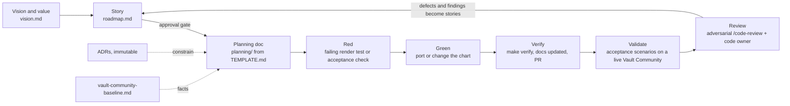

# The method — vision → story → plan → red → green → verify → validate → review

How this extension is built. It is the same customised, BMAD-derived method we
run in our other projects (kube-ward, kube-census, Hestia), adapted to a Helm
extension whose isolation is only proven on a live Vault Community. It is **not
aspiration**: every practice below is enforced *somewhere concrete* — a CI
check, a `make` target, a code-owner review, an immutable doc — and the
"Enforced by" column says where. Where a practice is *not yet* enforced
mechanically, this document says so, and the gap is a story rather than a
footnote.

## The loop



Two loops. The **inner loop** (story → plan → red → green → verify) ships one
story. The **outer loop** validates on a live Vault Community install against
`acceptance.md` — the isolation contract is only proven there, not by green
render tests — and turns every finding into a story. A fix is only done when a
regression test pins the behaviour it fixed.

## Practices, and where each is enforced

| Practice | Lineage | Here | Enforced by |
|---|---|---|---|
| Spec first | spec-driven development | vision → story → planning doc **before** chart changes | `make method`: an 🔨 In progress or ✅ Done story fails without a planning doc that cites it |
| Story-driven | user stories | house format, lifecycle marker, **Done:** line, acceptance ids | `make method`: unknown status, wrong marker, duplicate code, or a missing Done line past Draft fails |
| One story at a time | WIP limit (kanban) | end to end, walking skeleton first | `make method`: more than one 🔨 In progress fails |
| Approval gate | human in the loop | 📝 Draft → 👍 Approved only by a human | `.github/CODEOWNERS` owns `docs/roadmap.md` and `docs/adr/`; branch protection requires a code owner's review |
| PRs trace to a story | traceability | every PR cites its story code | PR workflow: `check_method.py pr-body` fails without a known code or `No story: <reason>` |
| Immutable decisions | ADRs (Nygard) | `docs/adr/`, superseded never edited | PR workflow: `check_method.py adr-diff` fails if an Accepted ADR changes beyond `Superseded by ADR-NNNN`; `make method` checks status values and the index |
| Test first | TDD (Beck) | a failing render test (golden, schema, guard) or acceptance check before the change | review today; `make verify` once C.1 ports the render harness (gap below) |
| Green before done | Definition of Done | `make verify` green, output seen | `make verify` locally; the same target in CI on every PR |
| Docs move with the code | docs as source of truth | a change that leaves `docs/` stale is unfinished | `make lint` (markdownlint) and `make links` (every relative link resolves); review |
| Facts before design | evidence over inference | Vault behaviour cited to `vault-community-baseline.md` rows; unknowns marked VERIFY | review; C.0 |
| Live validation | acceptance testing | acceptance scenarios on Vault Community 2.1.1 | validation report per phase |
| Adversarial review | multi-agent verification | `/code-review`: independent finders → cross-verified findings | the review flow; a code owner's approval |
| The checks check | mutation testing | every guard in `hack/check_method.py` has a test that fails without it | `make test`, in CI |
| Honesty | — | "not verified" beats a confident guess | review |

### Known enforcement gaps (tracked, not hidden)

| Gap | Until it closes | Story |
|---|---|---|
| No chart yet, so "red first" has no render test to fail | review enforces test-first | C.1 ports the render harness into `make verify` |
| The `verify` check is not yet a required status check, so a red PR can still be merged | reviewers don't merge red | DX.1 |
| Nothing runs on each local edit (kube-ward has a PostToolUse hook) | `make verify` before pushing; CI is the backstop | DX.2 |

## Story lifecycle

**📝 Draft** — written down so it isn't lost; explicitly *not* agreed. May be
re-scoped or killed; killing a weak Draft is the method working. →
**👍 Approved** — a human said build it. The gate exists because
comply-by-default is the failure mode: an unapproved story never starts. →
**🔨 In progress** — one at a time, end to end, with its planning doc
committed. → **✅ Done** — the Done line met, `make verify` green, the planning
doc linked from the story.

## The planning doc is a context capsule

`planning/TEMPLATE.md` is the contract: a cold session, with no memory of this
conversation, must be able to execute the story from the planning doc alone —
the why, the governing ADRs and baseline rows, the exact files, the tests (red
first), and what is out of scope. If a planning doc needs its author present to
be actionable, it isn't done. Its first line after the title is
``Story: `docs/roadmap.md` <code>``; `make method` fails without it.

## Relationship to BMAD

This is BMAD (the spec-driven, multi-agent framework) with the same deliberate
customisations as kube-ward, kube-census and Hestia:

- BMAD's brief and PRD ↔ `vision.md`, `concepts.md` and `roadmap.md`.
- BMAD's architect phase ↔ **immutable** ADRs (BMAD's architecture doc is
  mutable; ours are append-only and superseded, never edited) plus `design.md`.
- BMAD's story files ↔ our **story + planning-doc** pair, with the
  context-capsule discipline and an explicit Draft → Approved gate.
- BMAD's QA gate ↔ `make verify` in CI, live validation against
  `acceptance.md`, and a multi-angle `/code-review`.

What we keep our own: **persistent memory and human gates instead of persona
handoffs** (one agent, multi-agent only where fan-out pays — review);
**immutable ADRs**; and an **outer loop** driven by live validation and
regression tests rather than personas signing off.

## Invariants of the method itself

1. **No chart change without a red test or acceptance check that demanded it.**
1. **No implementation without a committed plan; no plan without a story; no
   story built without approval.**
1. **Honesty over completeness** — "couldn't verify / not assessed" beats a
   confident guess, in status reports and docs alike. A claimed fix with no
   regression test is a Draft claim.
1. **Docs are the source of truth and move with the code** — a change that
   leaves `docs/` or an ADR stale is unfinished.
1. **Decisions are immutable once accepted** — change your mind by superseding
   an ADR, not editing it.

## Running the checks

```sh
make verify   # lint + links + method + test: the Definition of Done gate
make method   # roadmap, planning docs and ADR rules only
python3 hack/check_method.py adr-diff --base origin/main   # what CI runs on a PR
```

## When Vault Community changes

1. Update `vault-community-baseline.md` (version, changed rows, new VERIFY items).
1. Re-run the acceptance suite on the new version.
1. Supersede any ADR whose context changed.
